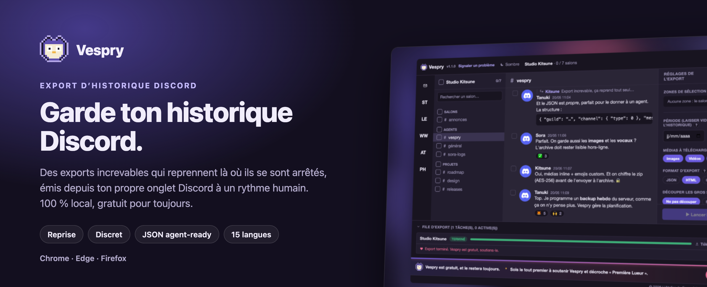
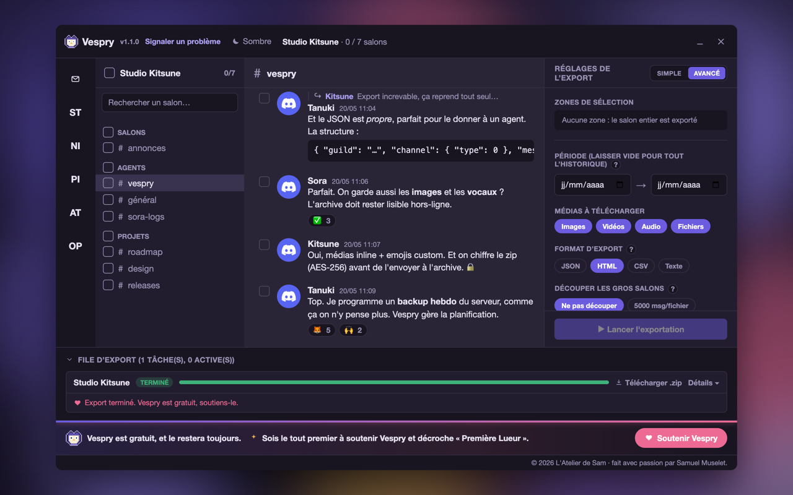
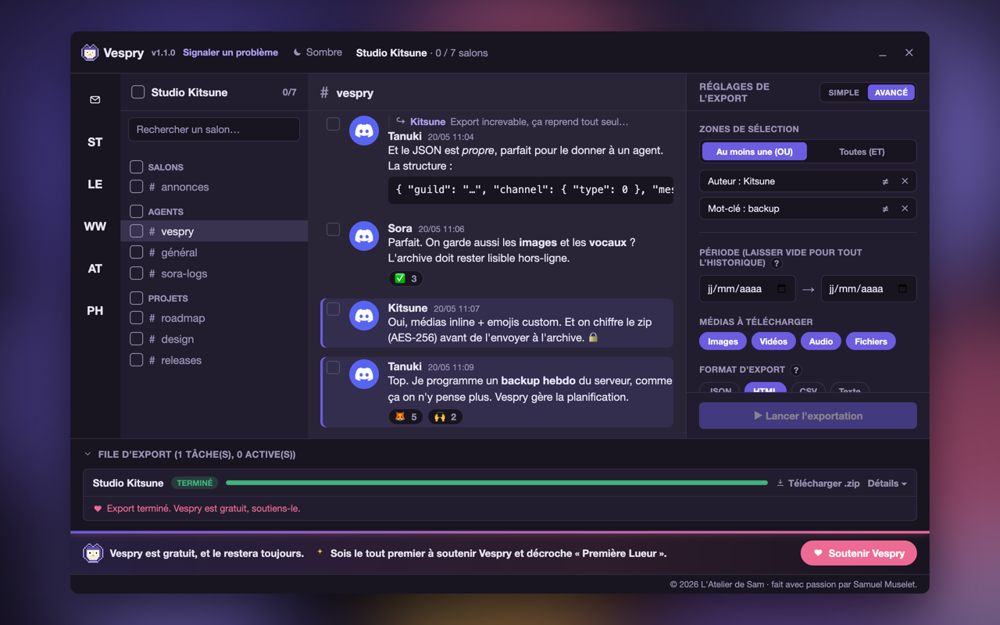
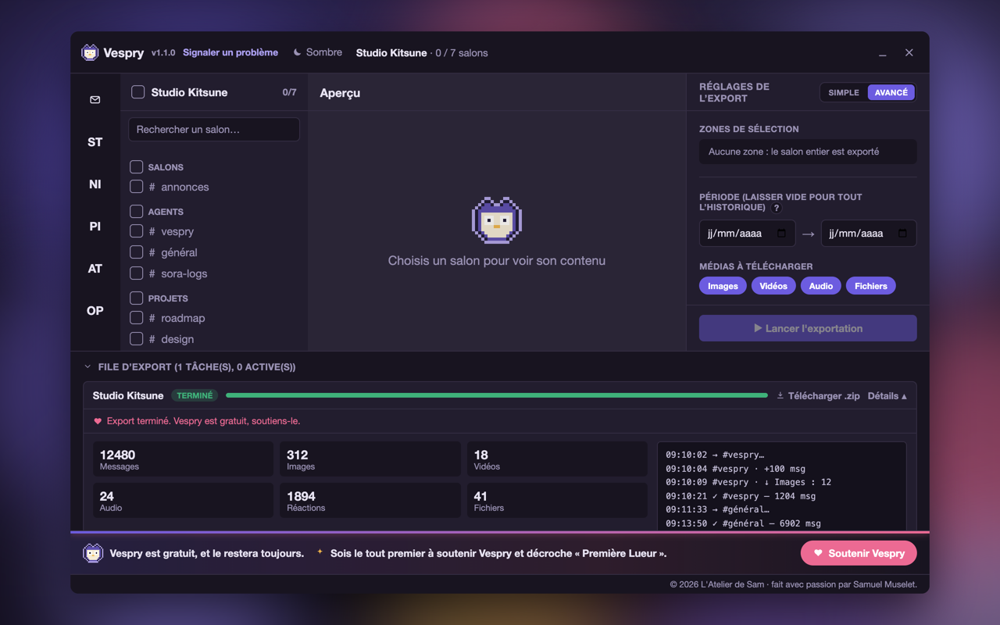
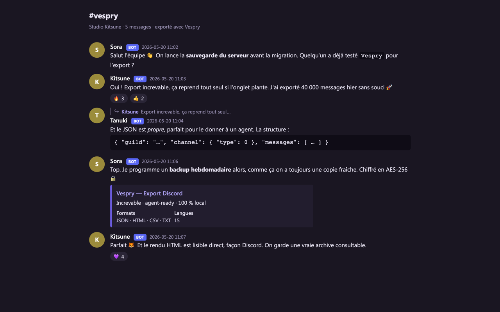

<div align="center">

<picture>
  <source media="(prefers-color-scheme: dark)" srcset="docs/brand/hero-fr-dark.png">
  <source media="(prefers-color-scheme: light)" srcset="docs/brand/hero-fr-light.png">
  
</picture>

<br/>

[](#-installation)
[](#-installation)
[](#-installation)
<br/>
[](https://github.com/atelier-sam/vespry/releases/latest)
[](https://github.com/atelier-sam/vespry/actions/workflows/ci.yml)
[](LICENSE)
[](https://developer.chrome.com/docs/extensions/develop/migrate)
[](tsconfig.json)

**[Installation](#-installation)** · **[Fonctionnalités](#-fonctionnalités)** · **[Mode discret](#️-mode-discret)** · **[Confidentialité](#-confidentialité)** · **[Soutenir Vespry 💜](#-soutenir-vespry)** · **[English](README.md)**

</div>

<br/>

> [!TIP]
> **Vespry est gratuit, sans publicité, sans compte, sans pistage.** Une seule
> personne le construit et l'entretient. S'il t'a sauvé l'historique d'un
> serveur, [**un café le fait vivre**](https://vespry-donors.sam-muselet.workers.dev/donate) ☕

<br/>

## 🦉 Pourquoi Vespry

Un serveur que tu quittes, une communauté qui ferme, des années de messages à
garder. Discord ne te laisse presque rien emporter. La plupart des extensions
d'export **cassent sur les gros serveurs** : elles chargent tout l'historique
d'un bloc, l'onglet manque de mémoire, et tu n'as rien.

Vespry prend le problème à l'envers :

- **Chaque lot de messages est écrit sur le disque** (IndexedDB) au fur et à
  mesure.
- Si l'export s'interrompt (onglet fermé, plantage, coupure), **il reprend
  depuis le dernier point enregistré** au lieu de tout recommencer.
- Si tu fermes l'onglet Discord, l'export **se met en pause** et repart tout
  seul à la prochaine ouverture de Discord.

Le résultat est une **archive `.zip` locale**, lisible par un humain comme par
un agent IA, que personne d'autre que toi ne voit passer.

<br/>

## 🕵️ Mode discret

Depuis mars 2026, Discord sanctionne des comptes qui exportent leur historique
avec des outils tiers : déconnexion forcée, restriction temporaire, suspension
en cas de récidive. Les outils qui interrogent l'API depuis leur propre
contexte, vite et en parallèle, ont une signature facile à repérer.

Vespry est construit pour ne pas en avoir :

- **Les requêtes partent de ton onglet discord.com**, par le client Discord
  lui-même : mêmes en-têtes, mêmes cookies, même version d'API. Aucune requête
  vers Discord ne part de l'extension.
- **Rythme humain par défaut** : un salon à la fois, 1,5 à 3,5 s entre deux
  lectures, une pause d'une dizaine de minutes toutes les 40 à 50 min, un
  plafond de requêtes par session. Un mode Normal, deux fois plus rapide, existe
  derrière un avertissement.
- **Arrêt au premier signal** : vérification, refus, page de protection ou
  demande de ralentir, l'export se met en pause et dit pourquoi. Pas de
  relance en rafale.
- **Moins de requêtes** : le comptage préalable est fait une fois, en série, et
  réutilisé au lancement.

Ça réduit le risque, ça ne le supprime pas : aucun outil ne peut garantir que
ton compte ne sera pas sanctionné. Vespry te le dit avant ton premier export,
dans ta langue.

<br/>

## ✨ Fonctionnalités

<table>
<tr>
<td width="50%" valign="top">

### 🛡️ Increvable
Reprise après interruption, écriture par lots sur disque, reprise
automatique à la réouverture de Discord. Le cœur du projet, couvert par les
tests.

</td>
<td width="50%" valign="top">

### 🔒 100 % local
Aucun serveur Vespry ne voit tes messages. Chiffrement AES-256 optionnel du
zip, mot de passe effacé dès l'archive fabriquée.

</td>
</tr>
<tr>
<td width="50%" valign="top">

### 🤖 Agent-ready
Sortie JSON structurée avec schéma documenté (`$schema`, `typeName`,
`localPath`) : prête à être donnée à un agent IA ou à ton second cerveau.
Format complet : [docs/SCHEMA.md](docs/SCHEMA.md).

</td>
<td width="50%" valign="top">

### 🗓️ Planifiable
Backup incrémental récurrent d'un serveur, quotidien ou hebdomadaire. Il part
dès qu'un onglet Discord est ouvert et te notifie.

</td>
</tr>
<tr>
<td width="50%" valign="top">

### 🎨 Quatre formats
JSON, HTML (façon Discord), CSV, TXT, plusieurs à la fois en une passe.
Avatars, emojis, vidéos et audio rangés en local.

</td>
<td width="50%" valign="top">

### 🌍 15 langues
Anglais, français, allemand, espagnol, italien, portugais, néerlandais,
polonais, finnois, turc, russe, japonais, coréen, chinois et hindi.

</td>
</tr>
</table>

<details>
<summary><strong>Voir le détail de chaque fonctionnalité</strong></summary>

<br/>

**Interface façon Discord** : à gauche, tes serveurs et conversations privées ;
au centre, l'aperçu des messages (markdown rendu, réponses citées, réactions,
stickers, embeds, médias inline) ; à droite, les réglages. Thème sombre ou
clair. Mode **Simple** par défaut, **Avancé** sur un clic.

**Multi-sélection de salons + plage de dates** : coche autant de salons que tu
veux et fixe une fenêtre temporelle ; la file traite chaque salon dans l'ordre.

**Sélection de messages un par un** : coche les messages voulus dans l'aperçu ;
ils s'ajoutent au panneau de droite. Combinable avec les filtres.

**Filtres booléens** : période, auteur, mot-clé, mention, épinglés, avec
image / vidéo / son / sticker / embed / lien. Les zones se combinent en **ET**
ou **OU**, et chacune peut être **inversée** (NON).

**Export incrémental** : un nouvel export ne récupère que les messages postés
depuis la dernière fois. La date du dernier export est affichée.

**Chiffrement AES-256** : mot de passe jamais envoyé, gardé le temps de
l'export (pour reprendre après une coupure) puis effacé. Jauge de force, et
avertissement clair : zip irrécupérable si le mot de passe est oublié.

**Modèles de nom de fichier** : `{guildName}-{date}.zip`,
`{datetime}-{guildName}.zip`, avec aperçu en direct.

**Découpage des gros salons** : 5 000 / 10 000 / 25 000 messages par fichier,
plutôt qu'un seul fichier ingérable.

**Suppression en masse** : triple garde-fou (sélection requise, fenêtre de
confirmation, saisie du mot de confirmation dans ta langue). Un message toutes
les 3 à 6 s en rythme Discret, arrêt au premier refus de Discord. Idempotente.

**File d'export** : avancement par tâche, journal en direct, badge de
pourcentage sur l'icône. Un export interrompu reprend.

**Tutoriel** au premier lancement, rejouable depuis le popup. Bouton
**Réinitialiser** qui efface toutes les données Vespry locales.

</details>

<br/>

## 📸 Captures

<table>
<tr>
<td width="50%"><br/><sub><b>Aperçu</b> : serveurs, salons, messages</sub></td>
<td width="50%"><br/><sub><b>Mode Avancé</b> : zones ET / OU / NON, formats, médias</sub></td>
</tr>
<tr>
<td width="50%"><br/><sub><b>File d'export</b> : journal en direct et totaux</sub></td>
<td width="50%"><br/><sub><b>Export HTML</b> : une archive consultable, façon Discord</sub></td>
</tr>
</table>

<sub>Captures faites sur un serveur de démonstration aux données inventées : aucun vrai serveur n'y apparaît.</sub>

<br/>

## 📊 Vespry face aux autres outils

| | Vespry | DiscordChatExporter | Discrub | Extensions freemium |
|---|:--:|:--:|:--:|:--:|
| Type | extension | appli desktop | extension | extension |
| **Reprise après interruption** | ✅ | ❌ | ❌ | ❌ |
| **Requêtes émises par le client Discord** | ✅ | ❌ | ❌ | ? |
| **Rythme humain + arrêt au premier refus** | ✅ | ❌ | partiel | ? |
| **Export incrémental natif** | ✅ | partiel | ❌ | ⚠️ payant |
| **Plusieurs formats en un export** | ✅ | ❌ | ❌ | ❌ |
| Formats JSON / HTML / CSV / TXT | ✅ | ✅ | JSON/HTML/CSV | variable |
| Découpage des gros salons | ✅ | ✅ | ✅ | ❌ |
| Filtres booléens (ET / OU / NON) | ✅ | ✅ texte | partiel | ❌ |
| Filtres `has:` (image, vidéo, sticker…) | ✅ | ✅ | ✅ | ❌ |
| Serveurs, forums, threads, DMs, groupes | ✅ | ✅ | ✅ | partiel |
| Réactions, embeds, stickers, réponses | ✅ | ✅ | ✅ | partiel |
| Téléchargement des médias | ✅ | ✅ | ✅ | ✅ |
| Aperçu avant export | ✅ | ❌ | ✅ | partiel |
| **Planification (quotidienne / hebdo)** | ✅ | ❌ | ❌ | ❌ |
| **Chiffrement zip AES-256** | ✅ | ❌ | ❌ | ❌ |
| **Modèles de nom de fichier** | ✅ | ❌ | ❌ | ❌ |
| Suppression en masse de messages | ✅ | ❌ | ✅ | ❌ |
| **Langues de l'interface** | **15** | limité | anglais | anglais |
| Gratuit, sans quota | ✅ | ✅ | ✅ | ❌ |
| Open source | ✅ MIT | ✅ MIT | ✅ MIT | ❌ |
| **Tout local, aucun compte externe** | ✅ | ✅ | ✅ | ❌ |
| Télémétrie | opt-in, OFF | aucune | ⚠️ | ❌ analytics |

<br/>

## 🚀 Installation

**Depuis les stores** (recommandé, mises à jour automatiques) : les fiches
Chrome Web Store, Microsoft Edge Add-ons et Firefox Add-ons arrivent. Les badges
du haut y mèneront dès que chaque store aura validé Vespry.

**À la main, en attendant** : télécharge la dernière
[version publiée](https://github.com/atelier-sam/vespry/releases/latest).

<table>
<tr>
<td valign="top" width="50%">

**Chrome · Edge · Brave · Opera · Arc**

1. Télécharge `vespry-<version>.zip` et décompresse-le.
2. Ouvre `chrome://extensions` et active le **mode développeur**.
3. **Charger l'extension non empaquetée** → choisis le dossier décompressé.
4. Ouvre Discord et connecte-toi : le bouton **Vespry** apparaît en haut à
   droite.

</td>
<td valign="top" width="50%">

**Firefox**

1. Télécharge `vespry_discord_export-<version>.zip`.
2. Ouvre `about:debugging#/runtime/this-firefox`.
3. **Charger un module complémentaire temporaire** → choisis le zip.
4. Ouvre Discord et connecte-toi.

</td>
</tr>
</table>

Installé à la main, Vespry te prévient quand une nouvelle version sort ;
installé depuis un store, c'est le store qui le met à jour, sans vérification
de sa part.

<br/>

## 💜 Soutenir Vespry

Vespry est gratuit, open source et sans publicité, et le restera. Les dons
paient l'hébergement et le temps passé à suivre les changements de Discord.
Choisis un montant : tu arrives sur une page sécurisée par Stripe, sans compte
à créer.

<p align="center">
  <a href="https://vespry-donors.sam-muselet.workers.dev/donate?amount=3"></a>
  <a href="https://vespry-donors.sam-muselet.workers.dev/donate?amount=5"></a>
  <a href="https://vespry-donors.sam-muselet.workers.dev/donate?amount=10"></a>
  <a href="https://vespry-donors.sam-muselet.workers.dev/donate"></a>
</p>

Tu choisis d'apparaître sur le **mur des soutiens** de l'extension, avec un
prénom et un petit mot, ou de rester anonyme. Le tout premier soutien décroche
le badge « Première Lueur ». Pas en mesure de donner ? Une ⭐ sur ce dépôt ou un
mot à un ami aide tout autant.

<br/>

## 📦 Le fichier exporté

L'export est une archive `.zip` autonome :

- les messages, dans les formats choisis, **un fichier par salon** ;
- les **médias téléchargés**, rangés dans des dossiers ;
- un `INDEX.md` qui explique le contenu, et un `manifest.json` lisible par une
  machine ;
- *(optionnel)* chiffrement **AES-256** si tu as fourni un mot de passe.

Arborescence, noms de fichiers et chaque champ JSON : [docs/SCHEMA.md](docs/SCHEMA.md)
(en anglais).

<br/>

## 🔐 Confidentialité

**Vespry tourne entièrement dans ton navigateur.** Tes conversations, les
médias, les exports : tout vit dans le stockage de ton navigateur puis dans le
`.zip` que tu télécharges. Rien ne transite par un serveur Vespry.

**Les seuls flux sortants, tous explicites :**

| Flux | Quand | Ce qui sort |
|---|---|---|
| **API Discord** | toujours | émis depuis ton onglet discord.com, par le client Discord |
| **CDN Discord** | médias de l'export | téléchargement par lien signé, sans jeton |
| **Stripe** | don uniquement | rien tant que tu ne donnes pas |
| **Service de dons** | mur des soutiens | lecture seule, soutiens publics |
| **GitHub** | crédits, vérification de version (installations à la main) | IP / User-Agent (requêtes anonymes) |
| **Signalement de format** | **opt-in, OFF** | uniquement les *noms* de nouveaux champs Discord |
| **Signaler un problème** | si tu cliques | formulaire GitHub public, pré-rempli et **masqué** (noms de serveur et de salons, identifiants, liens, e-mails) ; rien ne part sans ton clic sur « Submit » |

Aucune analytics, aucun pixel, aucun traceur. Détail complet dans
[`PRIVACY.md`](PRIVACY.md) ([English](PRIVACY.en.md)).

<br/>

## 🌍 Traductions

🇬🇧 English · 🇫🇷 Français · 🇩🇪 Deutsch · 🇪🇸 Español · 🇮🇹 Italiano ·
🇵🇹 Português · 🇳🇱 Nederlands · 🇵🇱 Polski · 🇫🇮 Suomi · 🇹🇷 Türkçe ·
🇷🇺 Русский · 🇯🇵 日本語 · 🇰🇷 한국어 · 🇨🇳 中文 · 🇮🇳 हिन्दी

Une phrase maladroite, une langue à ajouter ? Les textes sont dans
[`src/locales/`](src/locales), un fichier JSON par langue : ouvre une
[issue](https://github.com/atelier-sam/vespry/issues) ou une pull request.

<br/>

## 🛠️ Développement

```bash
npm install
npm run dev              # build en continu + HMR (Chrome)
npm run build            # build Chrome de production -> dist/
npm run build:firefox    # build Firefox de production -> dist-firefox/
npm run test             # tests unitaires (vitest)
npm run typecheck        # vérification de types
npm run firefox:lint     # web-ext lint pour AMO
```

TypeScript strict, Manifest V3, Vite, Preact. Le moteur d'export est couvert
par des tests unitaires : reprise d'un export interrompu, streaming AES-256,
suppression idempotente, et une garde qui interdit tout appel à l'API Discord
hors de l'onglet. Notes d'architecture : [`CLAUDE.md`](CLAUDE.md).

<br/>

## 💬 Contact

- 💡 **Proposer une idée** : [Discussions GitHub](https://github.com/atelier-sam/vespry/discussions/new?category=ideas)
- 🐛 **Signaler un bug** : [Issues GitHub](https://github.com/atelier-sam/vespry/issues), ou « Signaler un problème » dans l'extension
- 🔒 **Faille de sécurité** : [signalement privé](https://github.com/atelier-sam/vespry/security/advisories/new), voir [SECURITY.md](SECURITY.md)

<br/>

## ⚠️ Avertissement

Automatiser un compte utilisateur Discord est contraire aux conditions
d'utilisation de Discord, et Discord sanctionne des comptes qui exportent leur
historique depuis mars 2026. Le [mode discret](#️-mode-discret) réduit ce
risque sans le supprimer. Cet outil est fourni tel quel ; utilise-le sur tes
propres données, à tes risques. Avant ton premier export, Vespry affiche cet
avertissement dans ta langue et te demande de le valider. L'export officiel de
Discord (Paramètres → Données et confidentialité → Demander mes données) reste
la voie sans risque.

Vespry n'est pas affilié à Discord Inc. « Discord » et son logo sont des
marques de Discord Inc.

<br/>

## 📄 Licence

[MIT](LICENSE). Le client API Discord (`src/engine/discord-api.ts`) dérive de
Discrub Classic (MIT). « Discrub » est une marque de prathercc, non utilisée ici.

<div align="center">

<br/>

**© 2026 Samuel Muselet · [L'Atelier de Sam](https://atelier-sam.fr)**

<sub>fait avec passion 🦉</sub>

</div>
