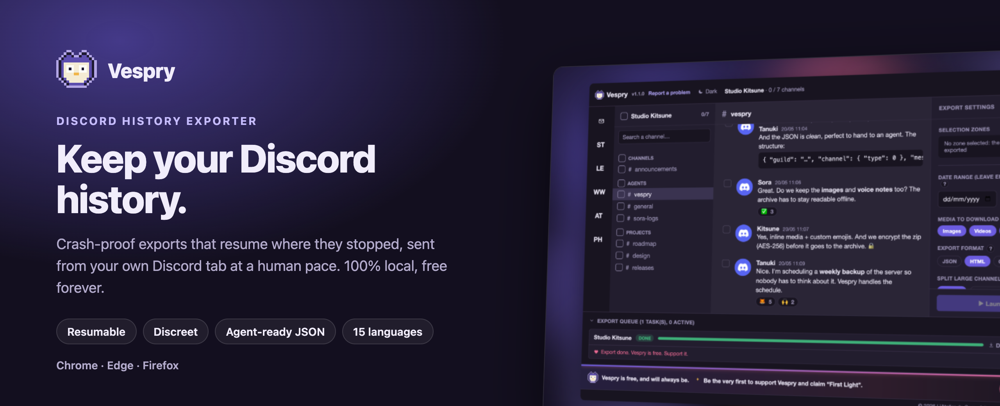
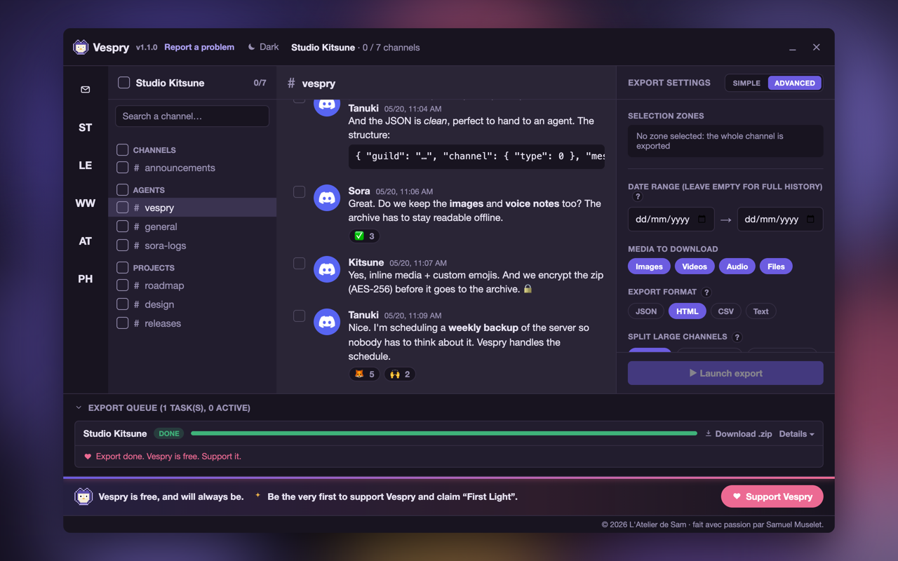
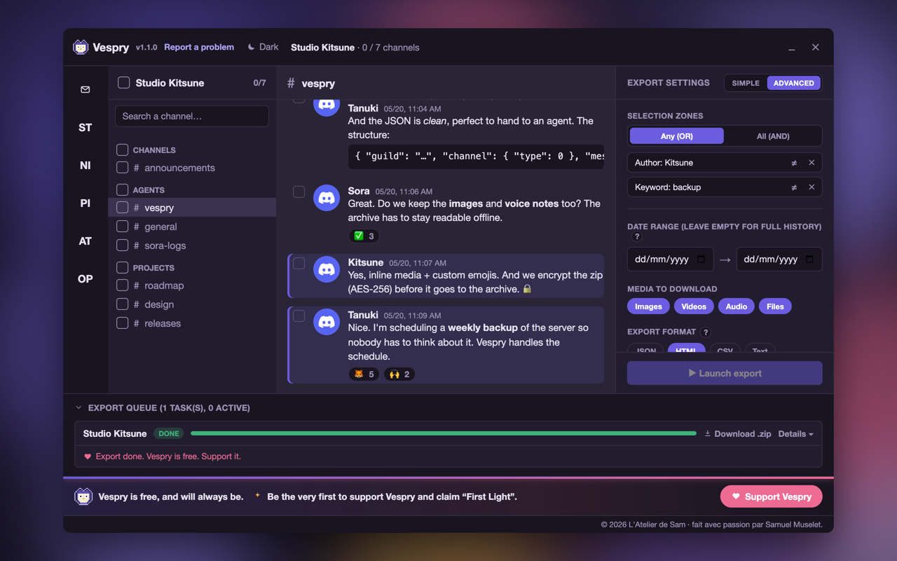
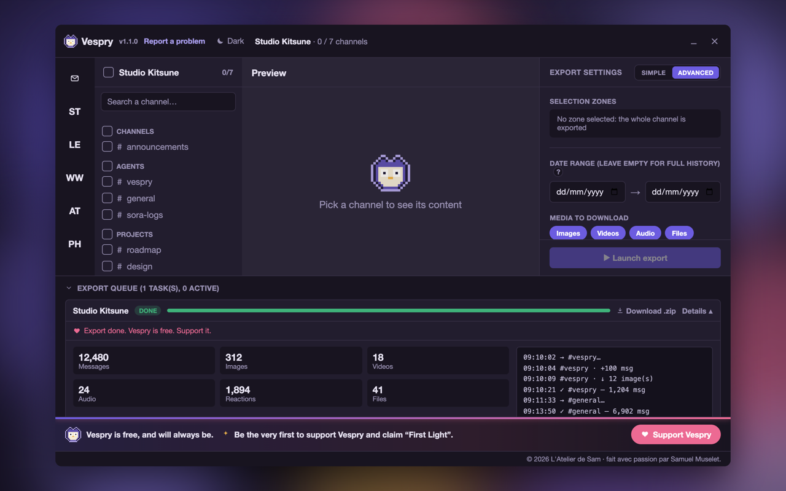
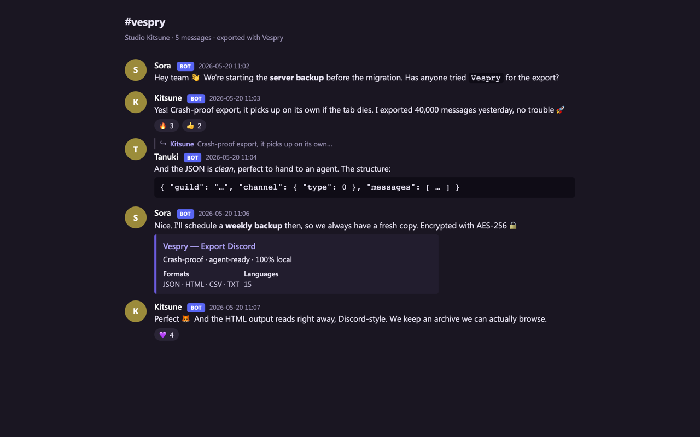

<div align="center">

<picture>
  <source media="(prefers-color-scheme: dark)" srcset="docs/brand/hero-en-dark.png">
  <source media="(prefers-color-scheme: light)" srcset="docs/brand/hero-en-light.png">
  
</picture>

<br/>

[](#-install)
[](#-install)
[](#-install)
<br/>
[](https://github.com/atelier-sam/vespry/releases/latest)
[](https://github.com/atelier-sam/vespry/actions/workflows/ci.yml)
[](LICENSE)
[](https://developer.chrome.com/docs/extensions/develop/migrate)
[](tsconfig.json)

**[Install](#-install)** · **[Features](#-features)** · **[Discreet mode](#️-discreet-mode)** · **[Privacy](#-privacy)** · **[Support Vespry 💜](#-support-vespry)** · **[Français](README.fr.md)**

</div>

<br/>

> [!TIP]
> **Vespry is free and has no ads, no account, no tracking.** It is built and
> maintained by one person. If it saves a server's worth of memories for you,
> [**a coffee keeps it going**](https://vespry-donors.sam-muselet.workers.dev/donate) ☕

<br/>

## 🦉 Why Vespry

A server you are leaving, a community about to shut down, years of messages you
want to keep. Discord lets you take almost nothing with you. Most export
extensions **break on large servers**: they load the whole history in one go,
the tab runs out of memory, and you are left with nothing.

Vespry turns the problem around:

- **Every batch of messages is written to disk** (IndexedDB) as it arrives.
- If the export stops (tab closed, crash, network loss), **it resumes from the
  last saved point** instead of starting over.
- Close the Discord tab and the export **pauses**, then picks up by itself the
  next time Discord is open.

The result is a **local `.zip` archive**, readable by a person as well as by an
AI agent, that nobody but you ever sees.

<br/>

## 🕵️ Discreet mode

Since March 2026, Discord has been sanctioning accounts that export their
history with third-party tools: forced logout, temporary restriction,
suspension for repeat cases. Tools that query the API from their own context,
fast and in parallel, leave an easy signature.

Vespry is built not to have one:

- **Requests leave from your discord.com tab**, sent by the Discord client
  itself: same headers, same cookies, same API version. No request to Discord
  ever leaves the extension.
- **Human pace by default**: one channel at a time, 1.5 to 3.5 s between reads,
  a pause of about ten minutes every 40 to 50 minutes, a per-session request
  cap. A Normal mode, twice as fast, sits behind a warning.
- **Stops at the first signal**: verification, refusal, protection page or
  "slow down", the export pauses and tells you why. No burst of retries.
- **Fewer requests**: the message count is done once, in series, and reused at
  launch.

This lowers the risk, it does not remove it: no tool can promise your account
won't be sanctioned. Vespry says so before your first export, in your language.

<br/>

## ✨ Features

<table>
<tr>
<td width="50%" valign="top">

### 🛡️ Crash-proof
Resumes after any interruption, writes to disk in batches, restarts on its own
when Discord reopens. The core of the project, covered by tests.

</td>
<td width="50%" valign="top">

### 🔒 100% local
No Vespry server ever sees your messages. Optional AES-256 encryption of the
zip; the password is erased as soon as the archive is built.

</td>
</tr>
<tr>
<td width="50%" valign="top">

### 🤖 Agent-ready
Structured JSON with a documented schema (`$schema`, `typeName`, `localPath`),
ready to hand to an AI agent or your second brain. Full format:
[docs/SCHEMA.md](docs/SCHEMA.md).

</td>
<td width="50%" valign="top">

### 🗓️ Scheduled backups
Recurring incremental backup of a server, daily or weekly. It runs as soon as
a Discord tab is open and notifies you.

</td>
</tr>
<tr>
<td width="50%" valign="top">

### 🎨 Four formats
JSON, HTML (Discord-style), CSV and TXT, several at once in a single pass.
Avatars, emojis, videos and audio stored locally.

</td>
<td width="50%" valign="top">

### 🌍 15 languages
English, French, German, Spanish, Italian, Portuguese, Dutch, Polish, Finnish,
Turkish, Russian, Japanese, Korean, Chinese and Hindi.

</td>
</tr>
</table>

<details>
<summary><strong>Every feature in detail</strong></summary>

<br/>

**Discord-like interface**: your servers and direct messages on the left, a
message preview in the middle (rendered markdown, quoted replies, reactions,
stickers, embeds, inline media), settings on the right. Dark or light theme.
**Simple** mode by default, **Advanced** one click away.

**Multi-channel selection + date range**: tick as many channels as you want and
set a time window; the queue handles each channel in turn.

**Pick messages one by one**: tick messages in the preview; they join the
selection on the right. Works together with filters.

**Boolean filters**: period, author, keyword, mention, pinned, has image /
video / sound / sticker / embed / link. Zones combine with **AND** or **OR**,
and each can be **inverted** (NOT).

**Incremental export**: a new export only fetches messages posted since the
last one. The date of the last export is shown.

**AES-256 encryption**: the password is never sent anywhere, kept only for the
duration of the export (to resume after an interruption), then erased. Strength
meter, and a clear warning: a forgotten password means an unrecoverable zip.

**File name templates**: `{guildName}-{date}.zip`, `{datetime}-{guildName}.zip`,
with a live preview.

**Large channel splitting**: 5,000 / 10,000 / 25,000 messages per file instead
of one unmanageable file.

**Bulk delete**: triple safeguard (selection required, confirmation dialog,
typing the confirmation word in your language). One message every 3 to 6 s in
Discreet pace, stops at Discord's first refusal. Idempotent.

**Export queue**: progress per task, live log, percentage badge on the toolbar
icon. Interrupted exports resume.

**Guided tour** on first launch, replayable from the popup. **Reset** button
that erases all local Vespry data.

</details>

<br/>

## 📸 Screenshots

<table>
<tr>
<td width="50%"><br/><sub><b>Preview</b>: servers, channels, messages</sub></td>
<td width="50%"><br/><sub><b>Advanced mode</b>: AND / OR / NOT zones, formats, media</sub></td>
</tr>
<tr>
<td width="50%"><br/><sub><b>Export queue</b>: live log and totals</sub></td>
<td width="50%"><br/><sub><b>HTML export</b>: a browsable archive, Discord-style</sub></td>
</tr>
</table>

<sub>Screenshots use a demo server with made-up data: no real server is shown.</sub>

<br/>

## 📊 Vespry compared

| | Vespry | DiscordChatExporter | Discrub | Freemium extensions |
|---|:--:|:--:|:--:|:--:|
| Type | extension | desktop app | extension | extension |
| **Resumes after interruption** | ✅ | ❌ | ❌ | ❌ |
| **Requests sent by the Discord client** | ✅ | ❌ | ❌ | ? |
| **Human pace + stop at first refusal** | ✅ | ❌ | partial | ? |
| **Native incremental export** | ✅ | partial | ❌ | ⚠️ paid |
| **Several formats in one export** | ✅ | ❌ | ❌ | ❌ |
| JSON / HTML / CSV / TXT | ✅ | ✅ | JSON/HTML/CSV | varies |
| Large channel splitting | ✅ | ✅ | ✅ | ❌ |
| Boolean filters (AND / OR / NOT) | ✅ | ✅ text | partial | ❌ |
| `has:` filters (image, video, sticker…) | ✅ | ✅ | ✅ | ❌ |
| Servers, forums, threads, DMs, groups | ✅ | ✅ | ✅ | partial |
| Reactions, embeds, stickers, replies | ✅ | ✅ | ✅ | partial |
| Media download | ✅ | ✅ | ✅ | ✅ |
| Preview before export | ✅ | ❌ | ✅ | partial |
| **Scheduled backups (daily / weekly)** | ✅ | ❌ | ❌ | ❌ |
| **AES-256 zip encryption** | ✅ | ❌ | ❌ | ❌ |
| **File name templates** | ✅ | ❌ | ❌ | ❌ |
| Bulk message delete | ✅ | ❌ | ✅ | ❌ |
| **Interface languages** | **15** | limited | English | English |
| Free, no quota | ✅ | ✅ | ✅ | ❌ |
| Open source | ✅ MIT | ✅ MIT | ✅ MIT | ❌ |
| **Fully local, no external account** | ✅ | ✅ | ✅ | ❌ |
| Telemetry | opt-in, OFF | none | ⚠️ | ❌ analytics |

<br/>

## 🚀 Install

**From the stores** (recommended, automatic updates): Chrome Web Store,
Microsoft Edge Add-ons and Firefox Add-ons listings are on their way. The
badges at the top will link to them as soon as each store approves Vespry.

**By hand, in the meantime**: download the latest
[release](https://github.com/atelier-sam/vespry/releases/latest).

<table>
<tr>
<td valign="top" width="50%">

**Chrome · Edge · Brave · Opera · Arc**

1. Download `vespry-<version>.zip` and unzip it.
2. Open `chrome://extensions` and turn on **Developer mode**.
3. **Load unpacked** → pick the unzipped folder.
4. Open Discord and sign in: the **Vespry** button appears at the top right.

</td>
<td valign="top" width="50%">

**Firefox**

1. Download `vespry_discord_export-<version>.zip`.
2. Open `about:debugging#/runtime/this-firefox`.
3. **Load Temporary Add-on** → pick the zip.
4. Open Discord and sign in.

</td>
</tr>
</table>

A hand-installed Vespry tells you when a new release is out; a store install is
updated by the store and makes no such check.

<br/>

## 💜 Support Vespry

Vespry is free, open source and ad-free, and will stay that way. Donations pay
for hosting and for the time spent keeping up with Discord's changes. Pick an
amount: you land on a Stripe-secured page, no account needed.

<p align="center">
  <a href="https://vespry-donors.sam-muselet.workers.dev/donate?amount=3"></a>
  <a href="https://vespry-donors.sam-muselet.workers.dev/donate?amount=5"></a>
  <a href="https://vespry-donors.sam-muselet.workers.dev/donate?amount=10"></a>
  <a href="https://vespry-donors.sam-muselet.workers.dev/donate"></a>
</p>

You choose whether to appear on the **supporters wall** shown in the extension,
with a name and a short message, or to stay anonymous. The very first supporter
earns the "First Light" badge. Not in a position to give? A ⭐ on this repository
or a word to a friend helps just as much.

<br/>

## 📦 The exported file

The export is a self-contained `.zip`:

- messages in the formats you chose, **one file per channel**;
- **downloaded media**, sorted into folders;
- an `INDEX.md` that explains the content, and a machine-readable
  `manifest.json`;
- *(optional)* **AES-256** encryption when you set a password.

Layout, file naming and every JSON field: [docs/SCHEMA.md](docs/SCHEMA.md).

<br/>

## 🔐 Privacy

**Vespry runs entirely in your browser.** Your conversations, media and exports
live in your browser storage, then in the `.zip` you download. Nothing goes
through a Vespry server.

**The only outgoing traffic, all of it explicit:**

| Traffic | When | What leaves |
|---|---|---|
| **Discord API** | always | sent from your discord.com tab, by the Discord client |
| **Discord CDN** | export media | download through signed links, no token |
| **Stripe** | donation only | nothing unless you donate |
| **Donation service** | supporters wall | read-only, public supporters |
| **GitHub** | credits, version check (manual installs only) | IP / User-Agent (anonymous requests) |
| **Format report** | **opt-in, OFF** | only the *names* of new Discord fields |
| **Report a problem** | if you click | public GitHub form, pre-filled and **masked** (server and channel names, IDs, links, e-mails); nothing leaves until you click "Submit" |

No analytics, no pixel, no tracker. Full details in
[`PRIVACY.en.md`](PRIVACY.en.md) ([français](PRIVACY.md)).

<br/>

## 🌍 Translations

🇬🇧 English · 🇫🇷 Français · 🇩🇪 Deutsch · 🇪🇸 Español · 🇮🇹 Italiano ·
🇵🇹 Português · 🇳🇱 Nederlands · 🇵🇱 Polski · 🇫🇮 Suomi · 🇹🇷 Türkçe ·
🇷🇺 Русский · 🇯🇵 日本語 · 🇰🇷 한국어 · 🇨🇳 中文 · 🇮🇳 हिन्दी

Spotted a clumsy sentence, or want a new language? Strings live in
[`src/locales/`](src/locales), one JSON file per language: open an
[issue](https://github.com/atelier-sam/vespry/issues) or a pull request.

<br/>

## 🛠️ Development

```bash
npm install
npm run dev              # watch build + HMR (Chrome)
npm run build            # Chrome production build -> dist/
npm run build:firefox    # Firefox production build -> dist-firefox/
npm run test             # unit tests (vitest)
npm run typecheck        # type checking
npm run firefox:lint     # web-ext lint for AMO
```

TypeScript strict, Manifest V3, Vite, Preact. The export engine is covered by
unit tests: resuming an interrupted export, streaming AES-256, idempotent
deletion, and a guard that forbids any Discord API call outside the tab.
Architecture notes: [`CLAUDE.md`](CLAUDE.md).

<br/>

## 💬 Contact

- 💡 **Suggest an idea**: [GitHub Discussions](https://github.com/atelier-sam/vespry/discussions/new?category=ideas)
- 🐛 **Report a bug**: [GitHub Issues](https://github.com/atelier-sam/vespry/issues), or "Report a problem" in the extension
- 🔒 **Security issue**: [private report](https://github.com/atelier-sam/vespry/security/advisories/new), see [SECURITY.md](SECURITY.md)

<br/>

## ⚠️ Disclaimer

Automating a Discord user account goes against Discord's terms of service, and
Discord has been sanctioning accounts that export their history since March
2026. [Discreet mode](#️-discreet-mode) lowers that risk without removing it.
This tool is provided as is; use it on your own data, at your own risk. Before
your first export, Vespry shows this warning in your language and asks you to
accept it. Discord's official export (Settings → Data & Privacy → Request all
of my data) remains the risk-free way.

Vespry is not affiliated with Discord Inc. "Discord" and its logo are
trademarks of Discord Inc.

<br/>

## 📄 License

[MIT](LICENSE). The Discord API client (`src/engine/discord-api.ts`) derives from
Discrub Classic (MIT). "Discrub" is a trademark of prathercc, not used here.

<div align="center">

<br/>

**© 2026 Samuel Muselet · [L'Atelier de Sam](https://atelier-sam.fr)**

<sub>made with passion 🦉</sub>

</div>
